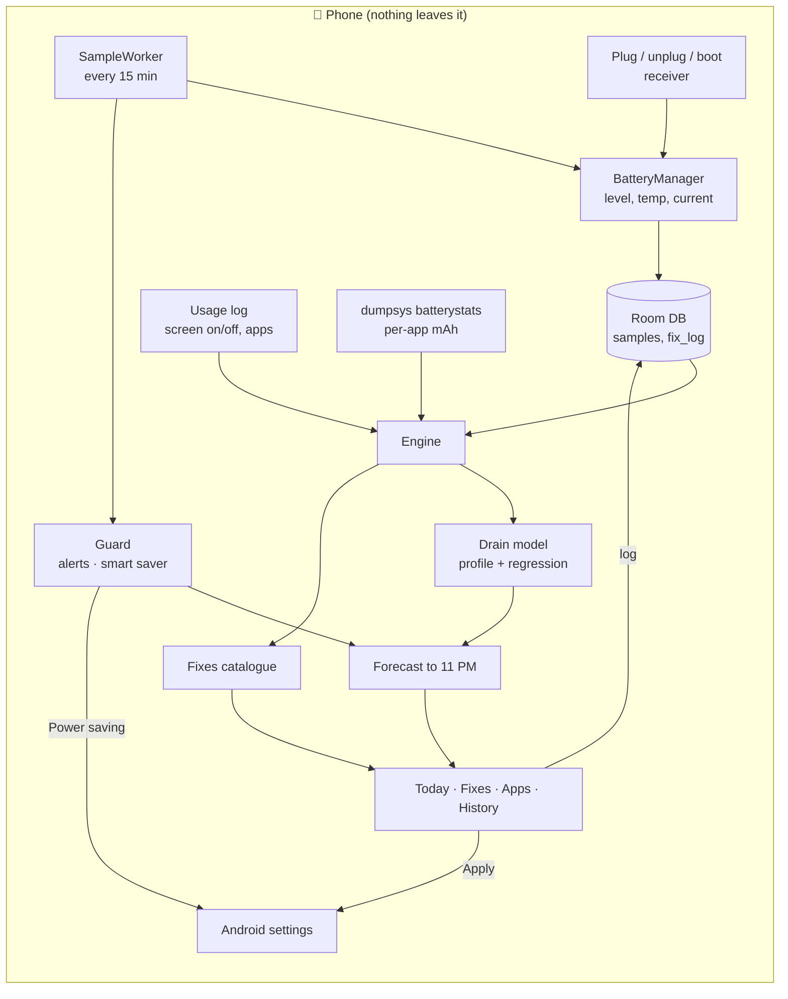
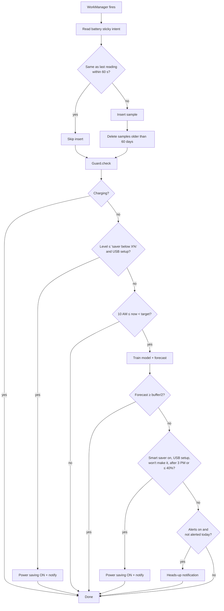
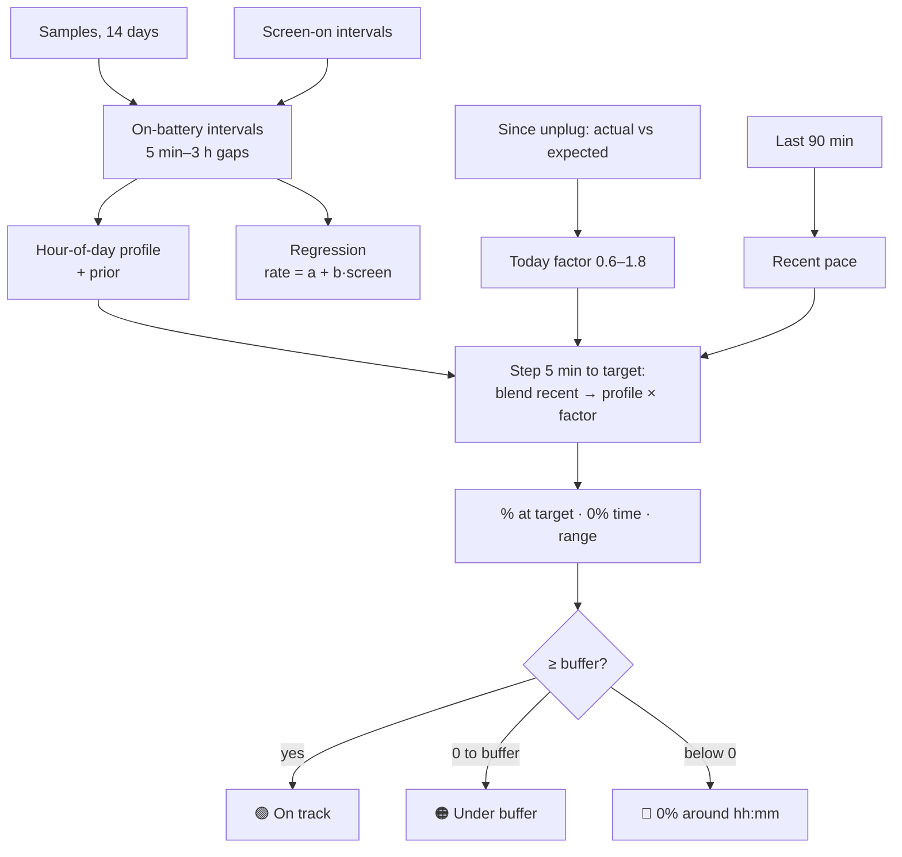
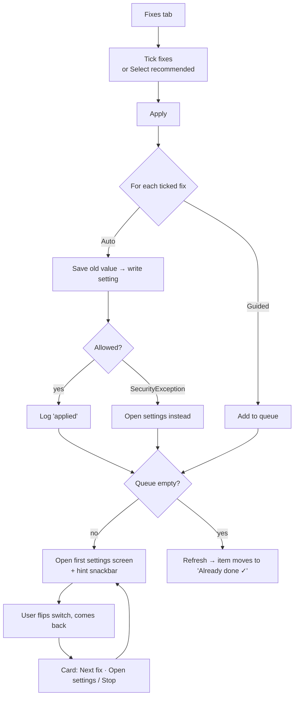
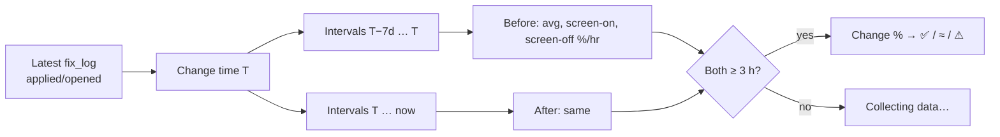
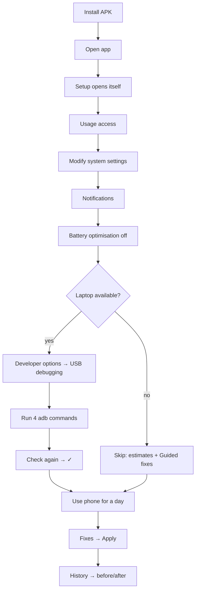

# BatteryPilot — Flowcharts

> These render as diagrams on GitHub (Mermaid).

## 1. System overview

## 2. Reading cycle (every ~15 min)

## 3. Forecast

## 4. Apply fixes (user flow)

## 5. Before / after

## 6. First-run setup

