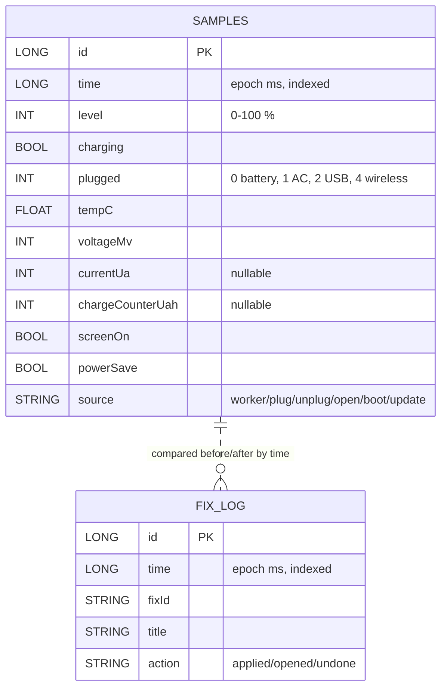

# BatteryPilot — Database

| Item | Value |
|---|---|
| Engine | Room (SQLite) |
| File | `batterypilot.db` (app-private storage) |
| Version | 1 · `fallbackToDestructiveMigration` (MVP) |
| Backup | Off (`allowBackup=false`) |
| Retention | Samples: 60 days rolling · Fix log: kept |

## 1. ER diagram

> No foreign key: the two tables are joined **by time** (before/after windows).

## 2. Table `samples`

| Column | Type | Null | Example | Notes |
|---|---|---|---|---|
| `id` | INTEGER PK auto | No | 1532 | — |
| `time` | INTEGER | No | 1792000000000 | Index `index_samples_time` |
| `level` | INTEGER | No | 62 | level × 100 / scale |
| `charging` | INTEGER (bool) | No | 0 | plugged ≠ 0 OR status charging/full |
| `plugged` | INTEGER | No | 0 | `BATTERY_PLUGGED_*` |
| `tempC` | REAL | No | 33.5 | EXTRA_TEMPERATURE / 10 |
| `voltageMv` | INTEGER | No | 3912 | — |
| `currentUa` | INTEGER | Yes | −480000 | Sign differs by phone |
| `chargeCounterUah` | INTEGER | Yes | 2790000 | Used for health estimate |
| `screenOn` | INTEGER (bool) | No | 1 | `PowerManager.isInteractive` |
| `powerSave` | INTEGER (bool) | No | 0 | `isPowerSaveMode` |
| `source` | TEXT | No | `worker` | What triggered the reading |

## 3. Table `fix_log`

| Column | Type | Null | Example |
|---|---|---|---|
| `id` | INTEGER PK auto | No | 7 |
| `time` | INTEGER | No | 1792000000000 |
| `fixId` | TEXT | No | `refresh_60`, `sleep:com.whatsapp` |
| `title` | TEXT | No | "Motion smoothness → Standard (60 Hz)" |
| `action` | TEXT | No | `applied` · `opened` · `undone` |

## 4. Queries (DAO)

| DAO | Method | SQL |
|---|---|---|
| SampleDao | `insert` | INSERT |
| | `since(from)` / `observeSince` | `SELECT * FROM samples WHERE time >= :from ORDER BY time` |
| | `latest()` | `… ORDER BY time DESC LIMIT 1` |
| | `count()` / `firstTime()` | `COUNT(*)` / `MIN(time)` |
| | `deleteBefore(t)` | `DELETE FROM samples WHERE time < :t` |
| FixLogDao | `insert`, `all()`, `observeAll()` | `SELECT * FROM fix_log ORDER BY time DESC` |

## 5. SharedPreferences `batterypilot`

| Key | Type | Default | Use |
|---|---|---|---|
| `targetHour` | int | 23 | Battery should last till (12–23) |
| `bufferPct` | int | 10 | % to keep at target (0–30) |
| `alertsOn` | bool | true | Heads-up notification |
| `smartSaver` | bool | false | Auto Power saving on forecast miss |
| `saverBelowPct` | int | 0 | 0 = off, else 20/30/40 |
| `lastAlertDay` | int | 0 | `yyyy*1000 + dayOfYear`, max 1 alert/day |
| `lastAutoSaverDay` | int | 0 | Max 1 auto Power saving/day |
| `prev_<fixId>` | string | — | Old setting value for Undo |
| `setupSeen` | bool | false | Reserved |

## 6. Size estimate

| Item | Value |
|---|---|
| Rows/day | ~100 (96 worker + events) |
| Row size | ~80 bytes |
| 60 days | ~6,000 rows ≈ **0.5 MB** |

## 7. Not stored (computed live)

| Data | Why not stored |
|---|---|
| Per-app mAh | `dumpsys` already keeps "since full charge"; re-read on open |
| Screen-on intervals / app usage | Android keeps the usage log; read on demand |
| Model + forecast | Cheap to retrain (< 50 ms) on every open/worker run |
