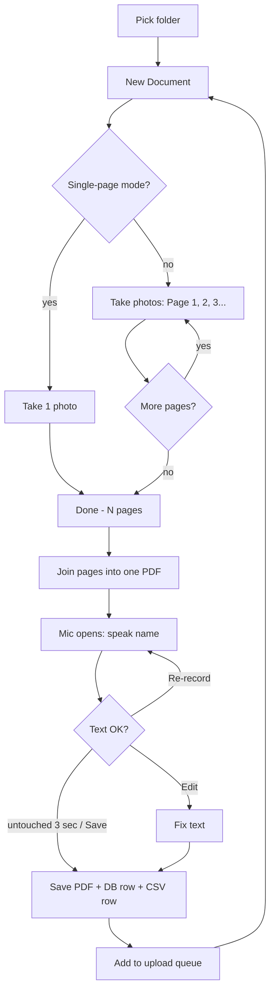
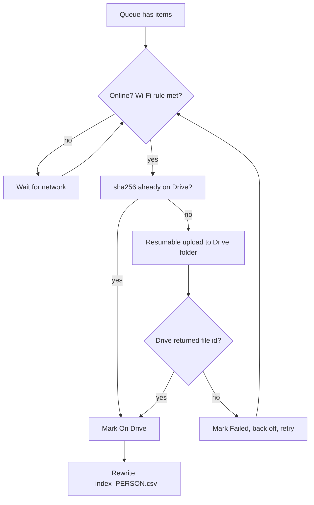
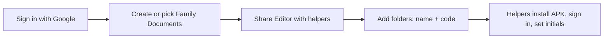

# DocSnap — Flowcharts

**TL;DR:** One loop per document (scan → Done → name → save → queue); uploads run separately in the background.

## 1. Scan a document

## 2. Upload worker

## 3. Owner setup (once)

