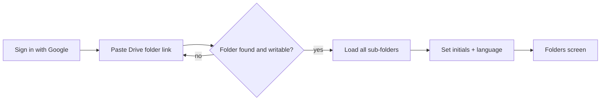
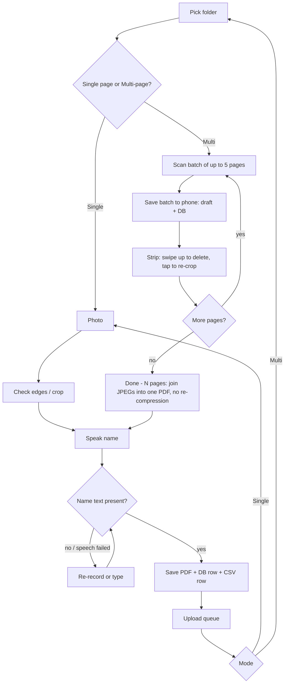
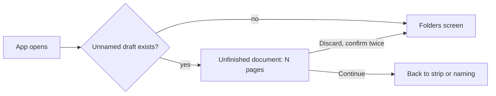
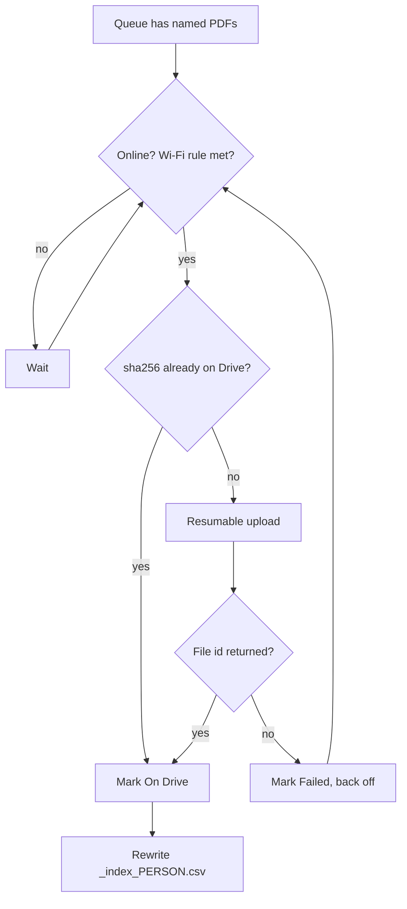
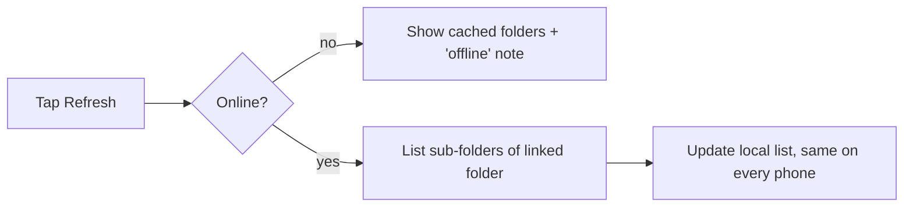

# DocSnap — Flowcharts

**TL;DR:** Connect once by folder link. Then per document: Single page (photo → name → next) or Multi-page (batches of 5 saved → Done → name). Name is compulsory. Uploads run in the background.

## 1. First launch

## 2. Scan

## 3. Crash recovery

## 4. Upload worker

## 5. Refresh folders

